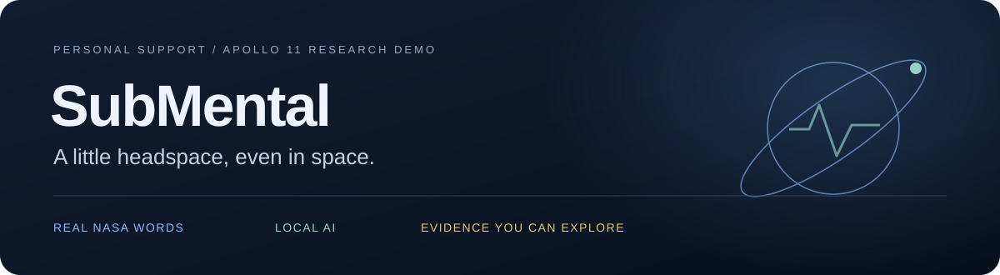
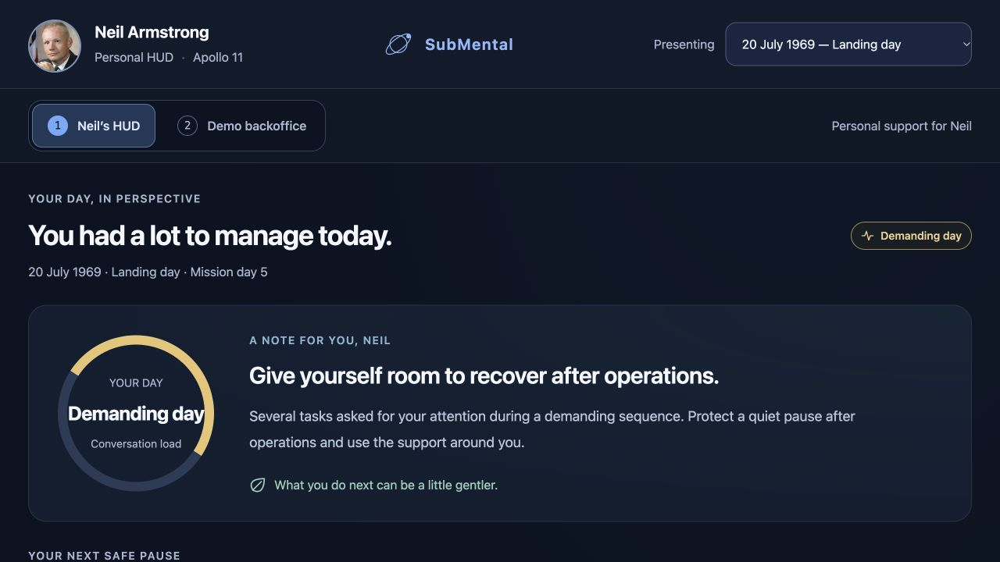
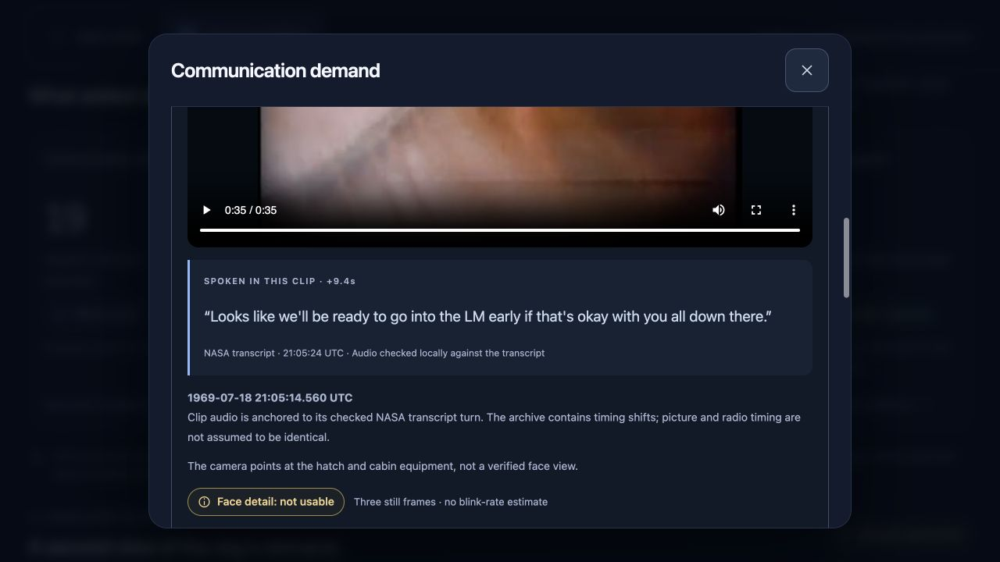
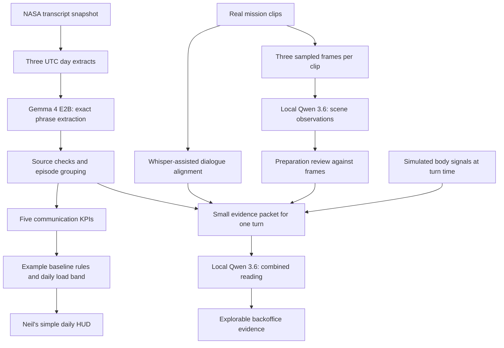

[**🚀 Explore the live SubMental demo →**](https://orbit-crewpulse.modernmimosa8.chatgpt.site/)

<div align="center">



**A personal astronaut HUD, built around conversations and evidence you can inspect.**

[](https://orbit-crewpulse.modernmimosa8.chatgpt.site/)
[](https://github.com/amirzaushnizer/submental/actions/workflows/ci.yml)


[The idea](#the-idea) · [Explore the demo](#explore-the-demo) · [Run locally](#run-locally) · [How it works](#how-it-works) · [Research](#research-that-shaped-the-project)

</div>

## The idea

Astronauts track their spacecraft closely. **SubMental helps them reflect on the person flying it.**

Our iPad-friendly research demo follows Neil Armstrong through three Apollo 11 mission days. Local AI models read real NASA conversations to explore communication demand, repeated instructions, coordination problems, expressed pressure and team support.

Neil gets a simple end-of-day view: how demanding the day was, what added load and a few gentle recovery suggestions. Behind the scenes, an explorable backoffice connects findings to their source words, simulated pulse and blood pressure, and real mission footage where matching audio is available.

Think Garmin-style daily reflection for space—with conversations at its heart.

> **A research prototype, not a diagnosis.** The conversations and mission footage are real. The body signals and personal baseline are simulated. The five KPIs and their thresholds are experimental product choices, not NASA-validated health measures.

## Explore the demo

**[Open SubMental →](https://orbit-crewpulse.modernmimosa8.chatgpt.site/)**

### Two views. One astronaut.

| Neil’s personal HUD | Demo backoffice |
| --- | --- |
| A qualitative daily load reading | Five communication KPIs with source-linked episodes |
| A short, supportive explanation | Exact quotes, UTC times, mission elapsed times and nearby dialogue |
| Three optional recovery actions | Simulated body signals at the selected turn’s time |
| A voluntary end-of-day check-in | Real clips, sampled frames, local model outputs and provenance |



Neil’s HUD uses concise, reviewed wording selected by the day’s load band. The backoffice also exposes the model’s original daily note. Check-ins and saved recovery actions are separated by selected day, stay in the current browser session and reset on reload.

### Three days of Apollo 11

| UTC date | Scenario | Transcript turns | Turns attributed to Neil |
| --- | --- | ---: | ---: |
| **18 July 1969** | Outbound flight and lunar-module checks | 850 | 68 |
| **20 July 1969** | Preparation, descent, landing and technical follow-up | 1,468 | 181 |
| **22 July 1969** | Return-journey operations and recovery opportunities | 504 | 55 |

These are **UTC calendar-day extracts**, not complete wake-to-sleep shifts. `CDR` denotes Neil. Real ground and crewmate messages remain as context; the app’s personal readings concern Neil.

### A two-minute presentation path

1. Start on **20 July → Neil’s HUD** to show the simple daily reflection.
2. Open **Demo backoffice** and inspect a KPI’s source words and matching simulated body readings.
3. Choose **18 July → Communication demand → With matching audio (2)**.
4. Open either checked example:
   - **21:05:24 UTC:** Neil asks to enter the lunar module early.
   - **22:11:34 UTC:** Neil asks whether horizontal banding on the TV monitor is being transmitted.
5. Play the original audio, inspect the NASA transcript caption and open the three frames sent to the vision model.

The app shows the spoken cue’s position in the clip. Local playback seeks just before it; some hosted players may play a short lead-in first. Other clips remain clearly labeled **reference only**.



## What is real—and what is simulated?

| Input or output | Status in this demo |
| --- | --- |
| Apollo 11 radio dialogue | **Real:** NASA’s uncorrected Technical Air-to-Ground transcript |
| Neil’s profile portrait | **Real:** NASA portrait, used for identity only |
| Five short mission clips and sampled frames | **Real:** NASA footage supplied through the Apollo Flight Journal |
| Text extraction, camera observations and combined readings | **Actual local model runs:** saved inputs, outputs and receipts are included |
| Pulse, systolic/diastolic blood pressure and felt tension | **Simulated:** scenario curves evaluated at the selected turn’s UTC time |
| Neil’s personal usual ranges | **Simulated:** no real personal baseline is available |
| Daily load bands | **Experimental:** explicit demonstration rules applied to communication counts |
| Recovery suggestions | **Reviewed catalog:** selected for the day’s load band; no automatic mission replanning |

A missing transcript is not silence. A question is not necessarily confusion. An equipment alarm is not a mental-health alarm. A captured reply is not proof that a task was completed.

## How it works



### 1. Conversations stay central

Gemma reviews substantive Neil turns with nearby dialogue. It extracts short, literal spans. Source checks reject spans absent from the text and filter unsupported interpretations. Nearby same-KPI turns within 90 seconds are grouped into episodes.

| KPI | What the demo looks for | What it does not establish |
| --- | --- | --- |
| **Communication demand** | Requests, decisions and actionable issues | A direct measurement of cognitive overload |
| **Effort to understand** | Repeats, restatements and corrections | That careful clarification is a failure |
| **Coordination strain** | Operational mismatches and relay problems | Interpersonal conflict |
| **Expressed pressure** | Neil explicitly describes being busy, divided attention or needing rest | A clinical stress diagnosis |
| **Team support** | A concrete issue or help request followed by a captured response | Resolution, task completion or a support quota |

The example usual ranges are 10–20 demand episodes, 0–2 understanding-effort episodes, 0–1 coordination snags and 0–1 explicit pressure statements. Support is shown as captured exchanges, without a readiness percentage. The day is marked demanding when demand exceeds 20 and at least two pressure episodes are found; other exceeded example ranges can produce a mixed-day reading. These are transparent demo rules, not clinical cutoffs.

### 2. Body signals travel with the turn

Each evidence turn displays its simulated pulse, blood pressure and tension at that exact UTC timestamp. They come from the same scenario curves as the day overview, rather than a separate unrelated dashboard. Switching turns switches the body readings too.

These values support the combined interpretation. They do **not** enter Gemma’s communication episode counts, and they are not Armstrong’s recorded medical measurements.

### 3. Camera input stays small and inspectable

The vision model receives **three still frames per clip**, with an 8K context cap. It describes visible scene details and image-quality limits. Those descriptions are checked against the frames; the original model responses remain available for inspection.

The combined model then receives one short packet: a source turn, its communication cues, simulated body readings and any checked camera evidence for that spoken turn. Reference footage is excluded from that packet.

A face that is small, shadowed, turned away or absent supplies no usable face evidence. Sparse frames cannot measure blink rate. The demo performs no automated identity matching or facial mental-health inference. The current checked KPI clips show work areas, not clear views of Neil’s face.

### 4. Spoken matches replace guessed video offsets

An early version linked clips using the declared broadcast start time. That was insufficient: the source video did not preserve a simple global offset. We removed those links.

A checked link now requires an explicit source turn ID, unchanged words and UTC timestamp, plus a recorded position in the clip’s audio. Whisper helped locate the dialogue and neighboring replies; NASA’s transcription supplies the captions. Radio noise can still cause ASR errors. Picture timing is not assumed to be identical to radio timing.

Build checks validate source references, frame hashes, video hashes, captions, body readings and saved local outputs before producing the app.

## Models used

| Model | Role | Where it runs |
| --- | --- | --- |
| **Gemma 4 E2B** — `gemma4:e2b` | Extract source phrases and write the original daily conversation note | Ollama, locally |
| **Qwen 3.6** — `qwen3.6:latest` | Describe sampled frames and write short combined evidence readings | Ollama, locally |
| **Whisper tiny.en** | Locate candidate spoken exchanges during preparation | Local CPU, through faster-whisper |
| **Whisper base.en** | Check recut clip audio and record speech positions | Local CPU, through faster-whisper |

No astronaut footage was sent to a cloud inference model. The browser app was developed with AI coding assistance; the table describes the models used to prepare the demo’s analysis.

The recorded developer machine was an **Apple M4 Pro with 48 GB unified memory**. The local Qwen runtime reported a 36B MoE model at Q4_K_M quantization; model tags can change. [The saved model manifest](docs/model-manifest.json) records installed digests and runtime metadata. No spacecraft hardware qualification or onboard power benchmark was performed.

Gemma 4 E4B was considered but not used. Saved model results are included so exploring the demo does not require downloading any model.

## Run locally

### Browse the saved demo

Requires **Node.js 22+** and npm. Python and Ollama are optional for this path.

```bash
git clone https://github.com/amirzaushnizer/submental.git
cd submental
npm ci
npm run build
npm run demo
```

Open **http://127.0.0.1:4180**.

The public hosted demo serves saved local results. It cannot start inference on a visitor’s computer. The local Node server enables live text reruns when Ollama and the selected model are available.

### Re-run local analysis

Install [Ollama](https://ollama.com/) and obtain the models:

```bash
ollama pull gemma4:e2b
ollama pull qwen3.6

# Re-run a single day's text analysis:
node scripts/local-analysis.cjs 1969-07-20

# Or all three days:
npm run analyze

# Refresh combined turn packets, then rebuild:
node scripts/combine-evidence.cjs
npm run build
npm test
```

The backoffice’s **Re-run this day locally** button refreshes that day’s text result in the running local app. Camera and combined-reading snapshots are regenerated through the preparation scripts.

### Rebuild transcript and camera inputs

This optional path needs **Python 3.12**, network access to source media and local models. Model inference may take several minutes.

```bash
python3 -m venv .venv
source .venv/bin/activate
pip install -r requirements-camera.txt

npm run prepare:data
npm run analyze

python scripts/prepare-camera.py
python scripts/check-camera-audio.py
node scripts/analyze-camera.cjs

# Inspect the sampled frames and update data/camera/review.json if needed.
node scripts/combine-evidence.cjs
npm run build
npm test
```

Re-extracting transcripts changes their input hashes; re-run the text analysis before building. Recutting media changes audio/frame hashes; repeat the relevant checks. Model tags, runtimes and generation can change results, even with a fixed seed. The checked-in snapshots are the reference demo, not a promise of bit-for-bit regeneration.

### Configuration

The `ORBIT_` names are retained from the project’s original working name.

| Variable | Default | Purpose |
| --- | --- | --- |
| `ORBIT_MODEL` | `gemma4:e2b` | Text analysis model |
| `ORBIT_VISION_MODEL` | `qwen3.6:latest` | Camera model |
| `ORBIT_FUSION_MODEL` | `qwen3.6:latest` | Combined-reading model |
| `ORBIT_OLLAMA_URL` | `http://127.0.0.1:11434` | Ollama endpoint |
| `ORBIT_PORT` | `4180` | Local demo port |
| `ORBIT_HOST` | `127.0.0.1` | Local server binding |
| `ORBIT_ASR_MODEL` | `base.en` | Optional audio-check model |
| `ORBIT_ASR_CACHE` | Runtime default | Optional Whisper model cache |

To present on a physical iPad on a trusted local network, start with `ORBIT_HOST=0.0.0.0 npm run demo` and open the Mac’s LAN address. Inference still runs on the Mac. The app is a tablet-oriented web prototype, not a native iPad application.

## Research that shaped the project

The research informed the **questions and boundaries** of this prototype. It does not validate our KPI rules or establish that NASA deploys SubMental-style monitoring.

| Paper or research source | What it contributed |
| --- | --- |
| [NASA Team Evidence Report (2022)](https://ntrs.nasa.gov/citations/20220007465) | Cooperation, coordination, communication and team-performance context |
| [Predicting Team Functioning in Long Term Space Missions Using Acoustic and Linguistic Measures (2026)](https://ntrs.nasa.gov/citations/20260005849) | HERA research combining acoustic and language features; team outcomes are distinct from individual mental health |
| [Supporting Exploration Missions by Enabling Exploration Mission System Software (2023)](https://ntrs.nasa.gov/citations/20230006625) | CODA and the value of linking timestamped communications to mission evidence |
| [Pilot Workload and Speech Analysis: A Preliminary Investigation (2013)](https://ntrs.nasa.gov/citations/20130013791) | Person-dependent voice responses and the limits of simple speech-to-workload assumptions |
| [ISS crew workload, fatigue, sleep disruption and circadian timing (2020)](https://ntrs.nasa.gov/citations/20205006969) | The need to consider work and recovery context |
| [Space-crew communication and mission-control style (2023)](https://doi.org/10.3389/fpsyg.2023.1169606) | Content analysis of Russian cosmonaut–ground communication; this is not a NASA all-crew conversation dataset |
| [Predicting Fatigue and Psychophysiological Test Performance from Speech (2015)](https://doi.org/10.3389/fbioe.2015.00124) | Controlled speech/fatigue research and its limits for spontaneous mission radio |
| [External Communication of Autonomous Crews Under Simulation of Interplanetary Missions (2021)](https://doi.org/10.3389/fphys.2021.751170) | Analog-mission communication and context-sensitive interpretation |

**[Read the annotated research guide →](docs/RESEARCH.md)** for NASA requirements, behavioral-health research, camera feasibility, scheduling resources, model documentation and limitations.

### Mission sources

- **Dialogue:** [NASA Apollo 11 Technical Air-to-Ground Transcript](https://www.nasa.gov/wp-content/uploads/static/history/alsj/a11/a11transcript_tec.html) and [transcript archive](https://www.nasa.gov/wp-content/uploads/static/history/alsj/a11/a11trans.html).
- **July 18 broadcast:** [Apollo Flight Journal — Entering Eagle](https://www.apollojournals.org/afj/ap11fj/09day3-entering-eagle.html).
- **Return broadcast:** [Television and Food Demonstrations](https://www.apollojournals.org/afj/ap11fj/23day7-tv-food-prep.html). The sample presentation is **23 July UTC**, outside the selected three dates.
- **Undated cabin film:** [Apollo 11 video index, magazine 1118-B](https://www.apollojournals.org/afj/ap11fj/videoindex.html). Exact mission time and original playback speed are not established for turn matching.
- **Portrait:** [NASA — Neil A. Armstrong](https://www.nasa.gov/people/neil-a-armstrong/).

The dataset uses the **uncorrected NASA technical transcript**, not a copied corrected Flight Journal transcript. OCR, speaker and timing errors can remain. [Data provenance and credits →](docs/DATA_PROVENANCE.md)

## Repository map

```text
src/                 Two-view React app, scenario curves and camera matching
scripts/             Extraction, local inference, audio checks, build and server
assets/              NASA portrait, short clips, sampled frames and captions
data/days/           Three source-preserving UTC transcript extracts
data/runs/           Saved Gemma results and raw responses
data/camera/         Catalog, local outputs, reviewed observations and audio checks
data/nasa/           Source snapshot and earlier landing-day research extracts
tests/               Source, timing, model-receipt and research-model checks
research-models/     Earlier experiments; not loaded by the current app
docs/                Research guide, provenance, model manifest and screenshots
```

The current app is Neil-only. Earlier schedule and multi-crew experiments are retained as clearly separated research code and tests. There is no live NASA schedule connector, continuous cabin recording feed, automatic rescheduling, clinical alerting or operational deployment.

## Checks and next steps

```bash
npm test
npm run build
```

The reference project has **35 automated checks**. The app was also checked in tablet layouts, with day switching, separate per-day choices, evidence filtering, real local text reruns, captioned playback and one-video-at-a-time audio. Public CI builds from the saved snapshots and does not require Ollama.

Future work would require human annotations, independent workload/self-report measures, coverage-aware comparisons and evaluation across people and tasks. A future authorized schedule adapter could add planned-versus-performed task context. The first useful question is whether the evidence helps the astronaut reflect—not whether we can produce a more impressive score.

---

**Built for exploration, with the person at the center.**

Historical media and portrait: NASA / Apollo Flight Journal. Research papers, dependencies and model weights retain their own terms. No NASA affiliation or endorsement is claimed. See [NOTICE.md](NOTICE.md) for credits and the repository’s licensing status.
